# Web Codexing


**通过手机网页，随时随地操作电脑上的 Codex。** 电脑继续执行任务，你用手机查看进度、追加一句引导，或回答它弹出的选择题。支持局域网访问，也可自行配置 Tailscale 实现外网访问。

[](LICENSE) [](package.json) [](#快速开始)

A lightweight, self-hosted web companion for your computer's Codex desktop chats. Access it on your LAN or remotely through your own Tailscale setup. Tailscale access has been verified by the maintainer on their own devices.

[手机功能](#手机上能做什么) · [快速开始](#快速开始) · [Tailscale 配置](docs/TAILSCALE.md) · [数据与安全](#数据与安全) · [参与开发](CONTRIBUTING.md)

> 非官方项目，与 OpenAI 无隶属或背书关系。当前为早期 Windows 原型，依赖桌面内部接口，升级 Codex 后可能需要适配。不是云端代跑服务，也不要求另购模型 API Key。

## 手机上能做什么


**看进度。** 左侧只显示最近 7 天有活动的会话，按最近活动倒序排列，也可搜索；实时跟进输出，过程消息默认折叠，想细看时批量展开，阅读历史后可以一键回到最新消息。更早的会话仍保留在电脑，“引用会话”中仍可搜索。

**停止、发送，两步就够。** 输入区只保留“停止”和“发送”。Codex 执行中点发送，会把消息放进上方的暂存队列，当前轮完成后按顺序自动继续。每条暂存消息只提供“引导、删除、编辑”：点“引导”立即追加到当前任务，不点就继续排队。已发出的引导仍用蓝色气泡区分，交回同一条桌面任务。

暂存只保留在当前网页内存，每个会话最多 5 条、全页最多 20 条；刷新、关闭页面会清空。自动继续需要本页前台连接到原会话、确认当前轮完成且没有待操作问题；一次只发一条，收到新轮次后再等待下一次完成。停止、失败或无法核对轮次会暂停队列，发送结果不明时不自动重试，不新增轮询。

**文件链接更好读。** NAS / Linux 路径和含空格、中文的 Windows 文件引用显示为紧凑卡片，完整路径默认收起，可展开并复制。卡片是路径引用，不代表已提供手机下载；不会根据任意聊天路径直接开放电脑文件。

<p>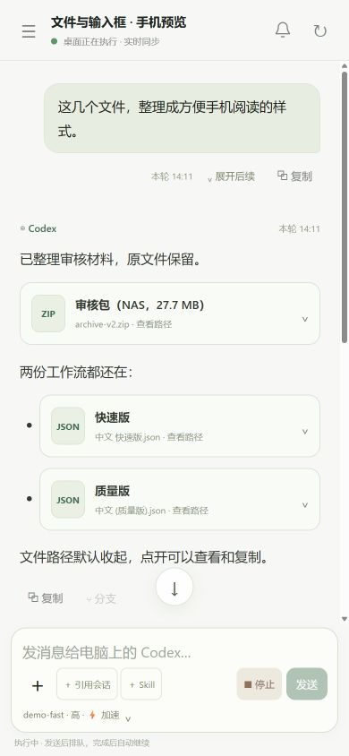 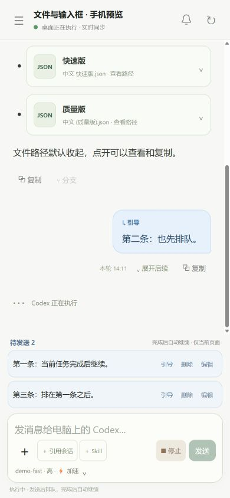</p>

**做决定。** 已适配的审批、选择和填写表单，可以直接在手机提交给原会话。系统登录、文件选择窗口等仍需在电脑处理。

**带上上下文。** 搜索并选择 Skill、引用其他会话，或为下一轮调整模型和思考档位。

**直接看生成图。** Codex 内置生成的成品图片按同一轮合并为图片组，显示在回复下方；手机上两列缩略图，点开放大、左右切换，也可保存原图。历史会话同样支持。仅读取已保存的成品图，不展示生成提示词和原始工具结果；原文件已删除时会提示无法读取。

<p>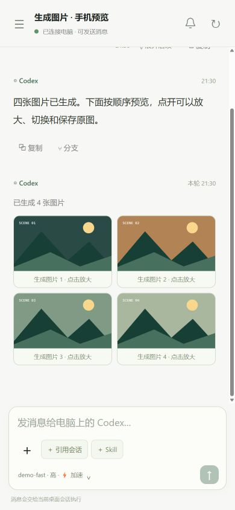</p>

引用会话会显示为可点击的标签，正文保留你输入的文字。新发送的引用按桌面客户端的上下文格式组织，支持普通消息、中途引导及与文件同时发送；旧版已发到桌面的展开说明不会被自动改写。读取引用与控制其他软件是不同操作，引用读取成功不代表其他软件的操作也成功。

**看转发消息和任务记录。** 来自其他会话的消息显示淡蓝色来源气泡，长内容可展开全文、复制，并跳转到仍可访问的来源会话。定时任务显示紧凑卡片，包含任务名称、执行频率和消息当时的启用 / 暂停状态；点“查看详情”阅读说明。卡片不代表任务的实时状态，当前设置需在电脑端查看。

<p></p>

此图使用隔离演示会话。两类内容复用历史分页和当前会话的实时连接，不新增后台轮询；展示记录不会创建、重跑或修改任务，也不会自动向来源会话发送消息。

**复制、粘贴与上传。** 每条消息下方可以复制；电脑网页支持 Ctrl+V 粘贴文字和截图，手机点输入框旁的「＋」从相册选择截图或上传文件。发送前显示附件预览，可以移除，支持纯附件发送；每条最多 8 个附件，每个最多 20 MB。图片会去除元数据并限制长边 4096 像素，避免传送过大的截图。

**从回复分支。** 一轮正式回复结束后，点下方的「分支」，确认后创建新会话，只保留到所选轮次为止的记录；原会话和草稿保留。分支交给本机 Codex 的原生接口创建，不会自动开始新任务。不完整的旧历史或尚未完成的回复暂不能分支。

<p>
  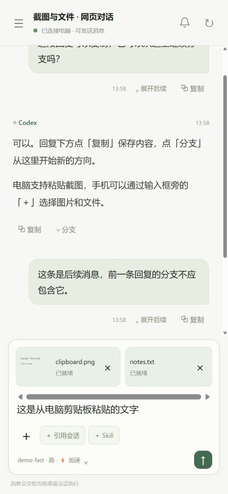
  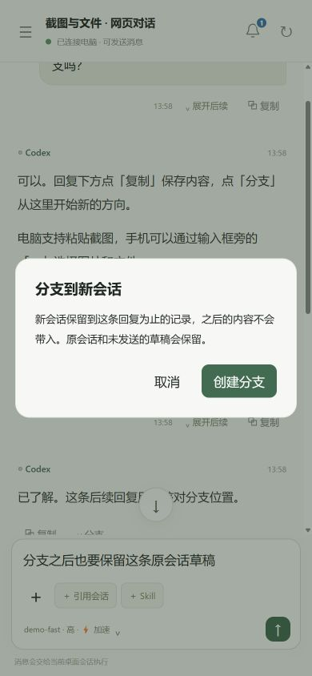
</p>

以上截图使用隔离的合成会话和文件。文字与图片粘贴已在电脑内置浏览器验证，手机上传使用同一文件选择入口；手机相册授权和具体机型表现仍以真机为准。局域网 HTTP 下，一键复制会尝试浏览器兼容方式；受浏览器权限限制时可手动选中文字复制。

**直接看图片和视频。** 图片先加载小尺寸缩略图，点击放大；同一条消息里的媒体可左右切换，图片支持手指滑动。视频显示播放卡片，点击才读取，支持进度拖动、播放器全屏和原文件下载；关闭预览或切到后台后停止传输。视频卡片使用轻量占位封面，不会为了取首帧预读视频或后台转码。

消息中的“手机预览图”等 `details / summary` 折叠块可以直接点开，图片和视频留在正文对应的位置，不会被移到回复顶部。折叠时不加载缩略图；代码块中的标签仍按代码显示，不执行任意 HTML。

<p>
  
  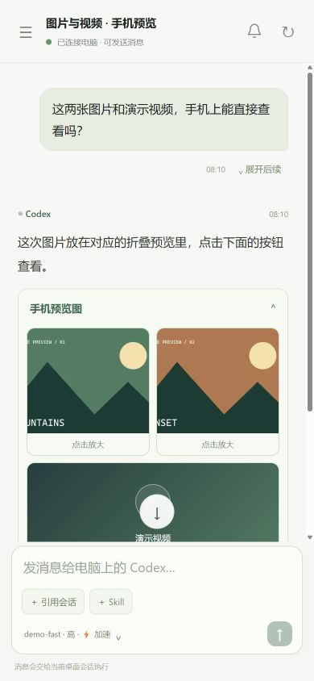
</p>

<p>
  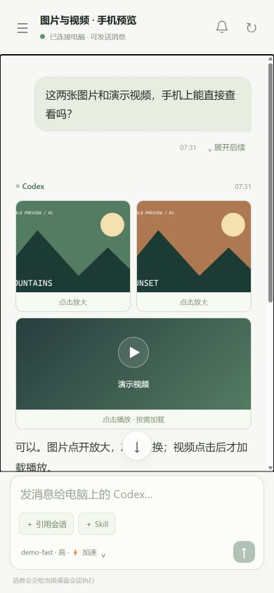
  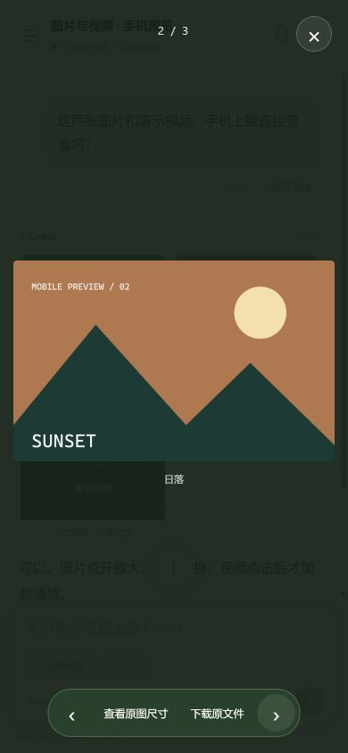
  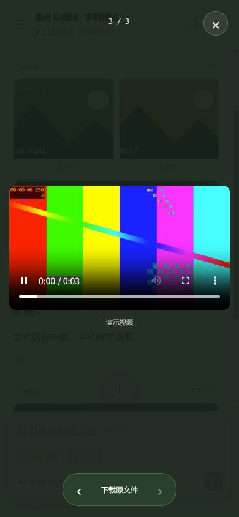
</p>

媒体截图使用本地合成演示文件，不包含真实会话或私人文件。

**知道什么时候该回来。** 其他会话完成或需要操作时，顶部出现一个小气泡，7 秒后收进铃铛角标。点气泡直接跳转，点铃铛集中查看，待操作优先。提示浮在内容上方，不挤页面、不抢输入焦点、不自动滚动；只有你主动点击才跳转，原会话的草稿会保留。

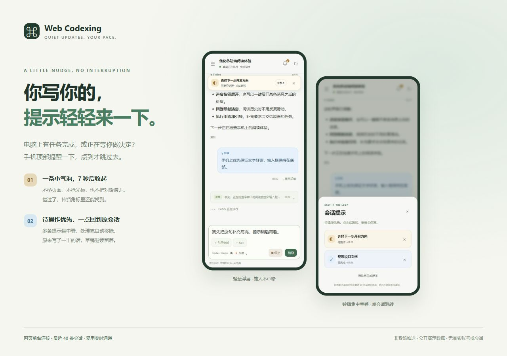

<details>
<summary>查看原始手机截图</summary>

截图均为演示数据，不包含真实会话、账号或电脑信息。点击图片可以查看大图。

<p>
  
  
  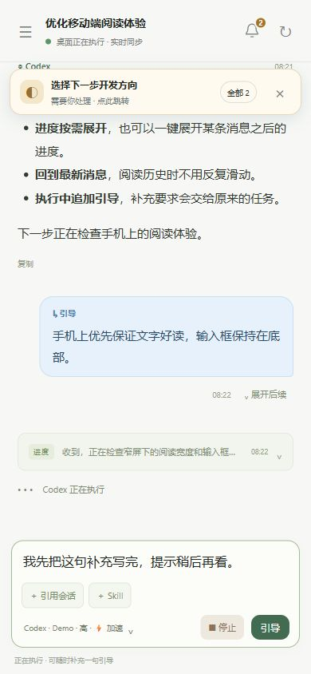
  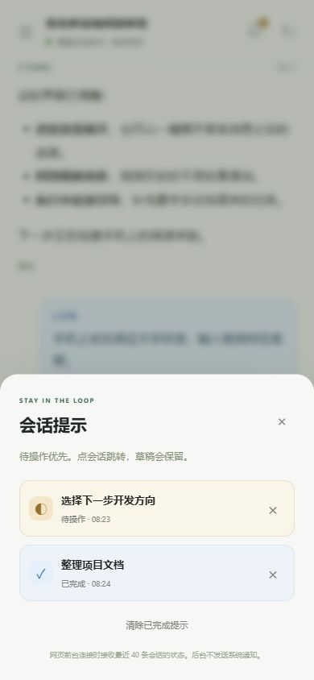
  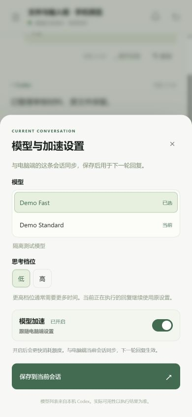
</p>

依次为对话与引导、选择问答、浮动气泡、提示列表，以及模型与加速设置。

</details>

<details>
<summary>查看完整功能清单</summary>

| 功能 | 当前行为 |
| --- | --- |
| 同一条桌面会话 | 左侧仅显示最近 7 天有活动的会话，按最近活动倒序；搜索、分页加载历史、实时同步当前进度；更早记录保留，会话引用仍可搜索 |
| 发送与中途引导 | 空闲时正常发送；执行时发送进入暂存队列，完成后按顺序自动继续；点队列“引导”立即发送，也可停止当前任务 |
| 审批与问答 | 转发已适配的命令 / 文件修改审批、选择题和填写表单，保留原问题标识 |
| 跨会话转发 | 显示原生转发正文及来源，长消息可折叠、复制、跳转；来源仍需在本机可访问 |
| 定时任务记录 | 显示创建、更新、查看回执中的任务名称、频率和当时状态；当前任务管理仍在电脑端操作 |
| 模型、思考档位与加速 | 读取当前环境目录和客户端加速状态；开关与当前桌面会话同步，客户端确认后显示保存成功，下一轮生效 |
| Skills 与会话引用 | 搜索当前工作目录可用 Skill；引用其他会话作为当前消息上下文 |
| 图片与视频 | 真实缩略图、点击放大、同条消息内切换与图片滑动；视频按需点播、分段读取、进度拖动、播放器全屏、原文件下载；关闭或后台停止传输 |
| 消息阅读 | 时间、消息和代码复制、正式回复按轮次分支、进度折叠、展开某条消息后的所有进度、回到最新消息 |
| 图片和文件上传 | 电脑粘贴截图、手机相册与文件选择、加号菜单、预览与移除；发送到同一桌面会话，单附件 20 MB、每条最多 8 个 |
| 会话状态 | 进行中、待操作、停止、异常；问题或审批优先显示待操作，确认处理后恢复实际状态；蓝点提示新完成且当前浏览器未查看的结果 |
| 轻量会话提示 | 完成 / 待操作气泡，7 秒后收进铃铛角标；多条提示合并，待操作优先，点击跳转，处理后自动恢复；不抢焦点、不改变页面布局或自动滚动 |
| 账号额度 | 紧凑显示当前电脑账号提供的额度与重置时间；不执行额度重置 |
| 手机配对 | 六位码、可选记住设备 30 天，电脑可撤销；可添加网页快捷方式到主屏幕 |
| 断线与恢复 | Codex 离线时保留当前页面历史和草稿，提示恢复连接；未加载会话可请求在电脑打开 |
| Windows 托盘 | 二维码、连接地址、运行状态；内嵌应用图标，一键创建桌面快捷方式；关闭面板后继续运行 |

会话引用不会向另一条会话发送消息。首次使用网页时，已有的完成记录作为基线，不显示蓝点；之后新完成、当前浏览器未查看的结果才提示，普通已完成会话不显示图标。蓝点和折叠偏好只影响当前浏览器，尚未同步桌面已读状态。模型目录不等于账号的模型访问保证。

提示针对**网页前台连接时最近 40 条会话**，列表最多保留 30 条提示，只显示会话标题和状态，不展示回复或问题正文。待操作必须经桌面当前状态确认，历史里未补答的问题不算当前待操作，也不会触发气泡；历史问题仍可在原消息旁手动展开补答。当前正在阅读到底部的结果不会重复弹气泡。待操作处理后自动移除，也可单独忽略提示或清除已完成提示；忽略提示不会替你回答问题或批准操作。浏览器只保存有上限的提示去重标识，不保存提示标题或聊天正文。它不是手机系统推送；切到后台或断开连接后暂停，返回前台时再核对。

提示复用同一条实时连接。所有手机共享一个仅在连接时存在的本机数据库文件监听，变化合并后最多每秒核对一次近期元数据；已有 20 秒连接心跳负责兜底核对，没有新增定时轮询。完成记录不订阅正文；进行中、待操作或近期停止的会话如需确认，仍共享下述状态查询预算，不新增全量会话订阅。没有前台连接时停止监听。

当前打开的会话通过已有实时连接更新状态；列表只检查屏幕内的条目（单次最多 24 条），打开列表、滚动后立即检查，可见时每 5 秒校对，手机后台或关闭列表时暂停。轻量加载检查与完整会话快照使用独立预算，共享最多 2 个并发和所有手机的缓存：每 5 秒最多 32 次轻量检查、4 次完整快照。加载状态缓存 5 秒，结果通过已有实时连接推送，不增加连接、不等待下一轮轮询。普通已完成会话只检查桌面归属，不订阅聊天正文；历史问答只读有上限的近期元数据，正文和图片不随列表刷新。列表以独立的“未加载”标签提示，历史仍可查看，待操作和蓝点状态保留。多台设备同时查看不同条目时会共享预算，较重查询仍可能分批完成。

</details>

## 快速开始

### 环境

- **电脑端：Windows**，已安装并登录 Codex 桌面，保持电脑开机、Codex 打开。
- **Node.js 24 或更新版本**，用于桥接服务和内置 SQLite。
- 手机 / 平板 / 电脑浏览器；局域网访问需能连接同一网络中的电脑。
- 编译托盘需 Windows 自带的 .NET Framework C# 编译器；不可用时仍可直接运行 Node 服务。

### 从源码运行

```powershell
git clone https://github.com/knownothing20/web-codexing.git
cd web-codexing
npm.cmd ci --ignore-scripts
powershell.exe -NoProfile -ExecutionPolicy Bypass -File .\build.ps1
.\start.cmd
```

在电脑面板中选择地址，手机扫码或打开地址，输入六位配对码。可勾选“记住这台手机 30 天”。配对码每次启动会变，已记住的设备仍可继续使用，直到过期或被撤销。

选择会话后即可操作。若提示会话未在电脑打开，点击“在电脑打开并连接”，或手动在桌面 Codex 打开原会话。旧 CLI 失败记录等桌面无法恢复的会话不保证可接管。

关闭连接面板会隐藏到托盘；右键托盘选择退出可停止桥接服务。`RemoteCoding.exe --exit` 也可请求正常退出。程序不自动修改防火墙；手机连接失败时检查 Windows 专用网络入站权限。

连接面板底部或托盘右键菜单中，点击“创建桌面快捷方式”，以后可直接从桌面启动。EXE、窗口、托盘和快捷方式使用统一图标，支持不同显示缩放。快捷方式指向原程序，不会复制整套文件，请保留原文件夹；移动程序后需要重新创建快捷方式。也可运行 `RemoteCoding.exe --create-shortcut` 创建，无需启动服务或管理员权限。已有同名快捷方式指向其他位置时会保留原文件并提示，不会直接覆盖。

不编译托盘也可 `npm.cmd start`；连接信息在本机 `.local/runtime.json`，仅在电脑上查看，不要上传或转发该文件。默认端口 `3210`，占用时尝试后续 9 个端口，以实际地址为准。

### 使用候选发布包

只有仓库实际提供 Release 时才有下载包。Windows ZIP 包含托盘启动器和源码，**不捆绑 Node.js 或依赖，也不是单文件安装器**。安装 Node.js 24+，解压后运行 `npm.cmd ci --omit=dev --ignore-scripts`，再双击 `start.cmd`。

### 离开局域网


**维护者已在自己的设备上验证通过 Tailscale 访问可用。** 在电脑与手机自行配置 Tailscale，连接自己的 tailnet，即可按自己的网络配置远程访问；使用 Tailscale IPv4 直连时，需启用本项目的可选支持。详见 [Tailscale 配置说明](docs/TAILSCALE.md)。无需开放路由器公网端口，本项目不会替你登录或配置 Tailscale。

## 数据与安全

- 本项目桥接不向第三方中继转发聊天；Codex 自身仍按原有配置连接模型服务。
- 手机按需读取历史与媒体，前台实时更新；后台暂停连接与视频，返回后补齐，无需反复刷新整页。
- 聊天正文和草稿只在页面内存中，刷新后重新读取。浏览器仍有配对 Cookie、会话 / 折叠 / 已读标记、界面及短期图片缓存。
- 媒体原文件留在电脑；只允许访问会话中已登记的图片与视频，不提供任意文件目录同步。缩略图按需压缩到最长边 480 像素，单任务处理，最多缓存 64 张 / 8 MB；视频每次按需分段读取，最多 4 个并发流，不整段装入内存，不新增媒体轮询。
- 多图长会话的桌面同步单帧上限为 128 MiB，接收时一次分配、分段写入，避免反复复制已接收的数据；大快照仍会临时占用相应内存，不增加轮询。超过上限的快照仍会被拒绝。
- **默认要求配对。** 电脑可开启“局域网免配对”，开启后可连接服务的允许来源都能读写会话，不建议用于共享网络或远程访问。
- 局域网 HTTP 不加密；Tailscale 模式由私有隧道保护传输。不直接映射公网。
- `.local/`、真实截图、数据库、证书和账号配置均不属于开源内容。更多见 [SECURITY.md](SECURITY.md)。

## 当前限制

- 仅支持 Windows 本机 Codex；手机上是浏览器界面，电脑必须持续在线。
- 使用桌面内部 Follower IPC。此前联调环境中的 CLI 版本为 `0.162.0-alpha.17.2`，这不代表兼容所有桌面版本；真实安装版本需自行验证。
- 新建 / 归档 / 重命名会话、远程主机切换、手机上传文件和语音尚未支持。
- 已适配的审批和选择填写可在网页处理；系统文件选择、登录窗口及未适配审批仍需在电脑操作。
- 图片支持本机 PNG/JPEG/GIF/WebP，最大 24 MB；不预览任意远程图片、SVG 或已删除原文件。
- 视频识别会话中明确附带或链接的本机 MP4/M4V/WebM/MOV，实际播放取决于手机浏览器支持的编码；不兼容时可下载原文件。远程链接仍作为链接打开，不代理下载，不自动访问其他电脑的媒体。只有工具输出、未在可见消息中附带的文件不会自动展示。
- 不显示隐藏推理或工具原始输出。发送结果不明时不自动重试，避免重复任务。
- Claude Code / WorkBuddy 实验适配器保留在源码，**默认关闭，未完成真实账号接入，不属于已支持功能**。
- 添加到手机桌面可作为网页快捷入口；没有完整离线 PWA，断开电脑后无法执行任务。

## 开发、检查与打包

```powershell
npm.cmd test                   # 协议 / HTTP / 安全测试，无真实模型调用
npm.cmd run privacy:check      # 发布范围、工作区和 Git 索引隐私检查
npm.cmd run release:check      # 隐私检查 + 测试
npm.cmd run preview:demo       # 独立演示页面，不连接真实 Codex
npm.cmd run package:source     # 检查后生成源码 ZIP
npm.cmd run package:windows    # 检查后编译托盘并生成 Windows ZIP
```

候选包位于本机 `dist/`，不自动上传。每次通过打包命令发布前都会检查隐私；GitHub Actions 也会检查 push / PR。脚本不能判断截图里的全部私人内容，仍需人工复核，详见 [发布流程](docs/PUBLISHING.md)。

README 介绍图使用 HTML / CSS 排版，源文件在 `docs/visuals/overview.html`，可用 `node scripts/preview-docs.mjs` 本机预览后截图；手机界面来自隔离演示服务，不读取真实账号。

[目录与公开 / 本地边界](docs/STRUCTURE.md) · [GitHub About 文案](docs/ABOUT.md) · [参与开发](CONTRIBUTING.md)

## 许可证

[MIT](LICENSE)。Codex、OpenAI 和 Tailscale 等名称及标识归各自所有者；本许可证仅覆盖本仓库有权许可的代码。
