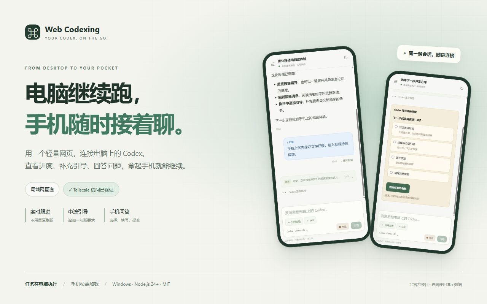
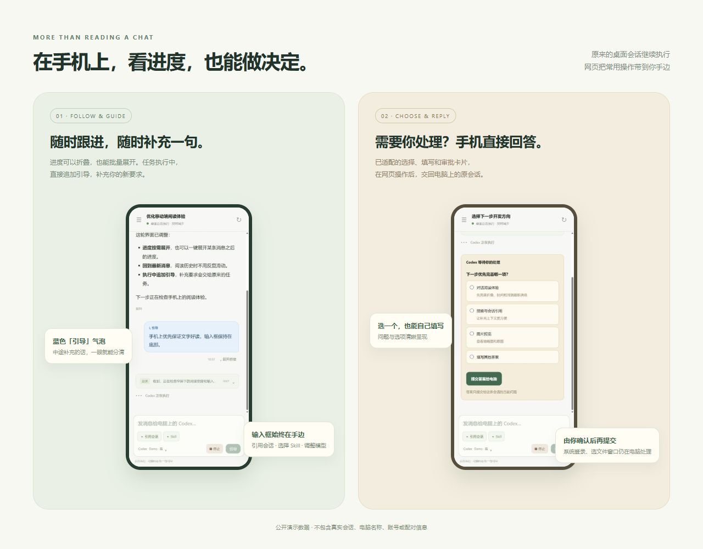
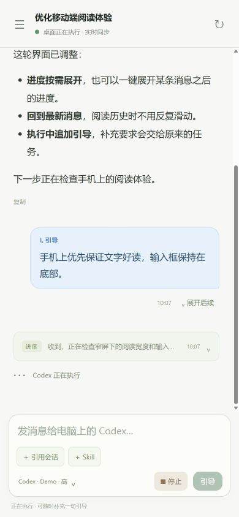
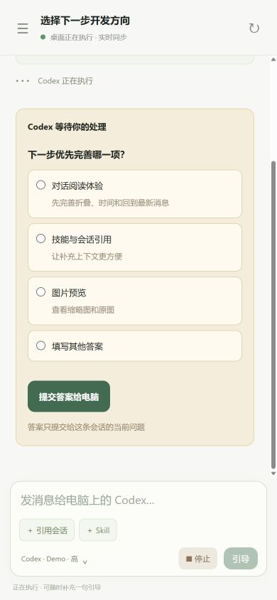
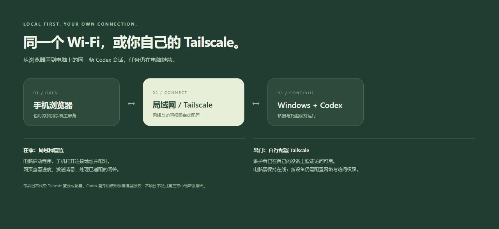

# Web Codexing



**通过手机网页，随时随地操作电脑上的 Codex。** 电脑继续执行任务，你用手机查看进度、追加一句引导，或回答它弹出的选择题。支持局域网访问，也可自行配置 Tailscale 实现外网访问。

[](LICENSE) [](package.json) [](#快速开始)

A lightweight, self-hosted web companion for your computer's Codex desktop chats. Access it on your LAN or remotely through your own Tailscale setup. Tailscale access has been verified by the maintainer on their own devices.

[手机功能](#手机上能做什么) · [快速开始](#快速开始) · [Tailscale 配置](docs/TAILSCALE.md) · [数据与安全](#数据与安全) · [参与开发](CONTRIBUTING.md)

> 非官方项目，与 OpenAI 无隶属或背书关系。当前为早期 Windows 原型，依赖桌面内部接口，升级 Codex 后可能需要适配。不是云端代跑服务，也不要求另购模型 API Key。

## 手机上能做什么



**看进度。** 搜索电脑上的会话，实时跟进输出；过程消息默认折叠，想细看时批量展开，阅读历史后可以一键回到最新消息。

**加一句引导。** Codex 正在执行时，也能补充新要求。引导用蓝色气泡区分，消息交回同一条桌面任务。

**做决定。** 已适配的审批、选择和填写表单，可以直接在手机提交给原会话。系统登录、文件选择窗口等仍需在电脑处理。

**带上上下文。** 搜索并选择 Skill、引用其他会话、查看图片，或为下一轮调整模型和思考档位。

<details>
<summary>查看原始手机截图</summary>

截图均为演示数据，不包含真实会话、账号或电脑信息。点击图片可以查看大图。

<p>
  
  
</p>

左：手机阅读对话、查看进度和中途追加引导。右：直接在手机选择答案并提交给电脑。

</details>

<details>
<summary>查看完整功能清单</summary>

| 功能 | 当前行为 |
| --- | --- |
| 同一条桌面会话 | 搜索、按最近活动排序、分页加载历史；实时同步当前进度 |
| 发送与中途引导 | 空闲时发送消息，执行时用“引导”追加要求；可停止当前任务 |
| 审批与问答 | 转发已适配的命令 / 文件修改审批、选择题和填写表单，保留原问题标识 |
| 模型与思考档位 | 读取当前环境目录，保存到当前会话，下一轮生效 |
| Skills 与会话引用 | 搜索当前工作目录可用 Skill；引用其他会话作为当前消息上下文 |
| 图片与消息阅读 | 缩略图、点击放大、时间、代码复制、进度折叠、展开某条消息后的所有进度、回到最新消息 |
| 会话状态 | 进行中、待操作、停止、异常；问题或审批优先显示待操作，确认处理后恢复实际状态；蓝点提示新完成且当前浏览器未查看的结果 |
| 账号额度 | 紧凑显示当前电脑账号提供的额度与重置时间；不执行额度重置 |
| 手机配对 | 六位码、可选记住设备 30 天，电脑可撤销；可添加网页快捷方式到主屏幕 |
| 断线与恢复 | Codex 离线时保留当前页面历史和草稿，提示恢复连接；未加载会话可请求在电脑打开 |
| Windows 托盘 | 二维码、连接地址、运行状态；关闭面板后继续运行 |

会话引用不会向另一条会话发送消息。首次使用网页时，已有的完成记录作为基线，不显示蓝点；之后新完成、当前浏览器未查看的结果才提示，普通已完成会话不显示图标。蓝点和折叠偏好只影响当前浏览器，尚未同步桌面已读状态。模型目录不等于账号的模型访问保证。

当前打开的会话通过已有实时连接更新状态；列表可见时每 5 秒批量校对状态、首页每 30 秒检查新增会话，手机后台或关闭列表时暂停。历史问答只读取有上限的近期元数据并缓存，不重复加载正文或图片；不明的进行中 / 已停止条目最多同时进行 2 个本机只读状态查询，每 5 秒最多 4 个，所有手机共享缓存。长列表首次校对会分批完成，不保证每一条都在 5 秒内确认。

</details>

## 快速开始

### 环境

- **电脑端：Windows**，已安装并登录 Codex 桌面，保持电脑开机、Codex 打开。
- **Node.js 24 或更新版本**，用于桥接服务和内置 SQLite。
- 手机 / 平板 / 电脑浏览器；局域网访问需能连接同一网络中的电脑。
- 编译托盘需 Windows 自带的 .NET Framework C# 编译器；不可用时仍可直接运行 Node 服务。

### 从源码运行

```powershell
git clone https://github.com/knownothing20/web-codexing.git
cd web-codexing
npm.cmd ci --ignore-scripts
powershell.exe -NoProfile -ExecutionPolicy Bypass -File .\build.ps1
.\start.cmd
```

在电脑面板中选择地址，手机扫码或打开地址，输入六位配对码。可勾选“记住这台手机 30 天”。配对码每次启动会变，已记住的设备仍可继续使用，直到过期或被撤销。

选择会话后即可操作。若提示会话未在电脑打开，点击“在电脑打开并连接”，或手动在桌面 Codex 打开原会话。旧 CLI 失败记录等桌面无法恢复的会话不保证可接管。

关闭连接面板会隐藏到托盘；右键托盘选择退出可停止桥接服务。`RemoteCoding.exe --exit` 也可请求正常退出。程序不自动修改防火墙；手机连接失败时检查 Windows 专用网络入站权限。

不编译托盘也可 `npm.cmd start`；连接信息在本机 `.local/runtime.json`，仅在电脑上查看，不要上传或转发该文件。默认端口 `3210`，占用时尝试后续 9 个端口，以实际地址为准。

### 使用候选发布包

只有仓库实际提供 Release 时才有下载包。Windows ZIP 包含托盘启动器和源码，**不捆绑 Node.js 或依赖，也不是单文件安装器**。安装 Node.js 24+，解压后运行 `npm.cmd ci --omit=dev --ignore-scripts`，再双击 `start.cmd`。

### 离开局域网



**维护者已在自己的设备上验证通过 Tailscale 访问可用。** 在电脑与手机自行配置 Tailscale，连接自己的 tailnet，即可按自己的网络配置远程访问；使用 Tailscale IPv4 直连时，需启用本项目的可选支持。详见 [Tailscale 配置说明](docs/TAILSCALE.md)。无需开放路由器公网端口，本项目不会替你登录或配置 Tailscale。

## 数据与安全

- 本项目桥接不向第三方中继转发聊天；Codex 自身仍按原有配置连接模型服务。
- 手机按需读取历史与图片，前台实时更新；后台暂停连接，返回后补齐，无需反复刷新整页。
- 聊天正文和草稿只在页面内存中，刷新后重新读取。浏览器仍有配对 Cookie、会话 / 折叠 / 已读标记、界面及短期图片缓存。
- 原图留在电脑；只允许访问会话中已登记的图片，不提供任意文件目录同步。
- **默认要求配对。** 电脑可开启“局域网免配对”，开启后可连接服务的允许来源都能读写会话，不建议用于共享网络或远程访问。
- 局域网 HTTP 不加密；Tailscale 模式由私有隧道保护传输。不直接映射公网。
- `.local/`、真实截图、数据库、证书和账号配置均不属于开源内容。更多见 [SECURITY.md](SECURITY.md)。

## 当前限制

- 仅支持 Windows 本机 Codex；手机上是浏览器界面，电脑必须持续在线。
- 使用桌面内部 Follower IPC。此前联调环境中的 CLI 版本为 `0.162.0-alpha.17.2`，这不代表兼容所有桌面版本；真实安装版本需自行验证。
- 新建 / 归档 / 重命名会话、远程主机切换、手机上传文件和语音尚未支持。
- 已适配的审批和选择填写可在网页处理；系统文件选择、登录窗口及未适配审批仍需在电脑操作。
- 图片支持本机 PNG/JPEG/GIF/WebP，最大 24 MB；不预览任意远程图片、SVG 或已删除原文件。
- 不显示隐藏推理或工具原始输出。发送结果不明时不自动重试，避免重复任务。
- Claude Code / WorkBuddy 实验适配器保留在源码，**默认关闭，未完成真实账号接入，不属于已支持功能**。
- 添加到手机桌面可作为网页快捷入口；没有完整离线 PWA，断开电脑后无法执行任务。

## 开发、检查与打包

```powershell
npm.cmd test                   # 协议 / HTTP / 安全测试，无真实模型调用
npm.cmd run privacy:check      # 发布范围、工作区和 Git 索引隐私检查
npm.cmd run release:check      # 隐私检查 + 测试
npm.cmd run preview:demo       # 独立演示页面，不连接真实 Codex
npm.cmd run package:source     # 检查后生成源码 ZIP
npm.cmd run package:windows    # 检查后编译托盘并生成 Windows ZIP
```

候选包位于本机 `dist/`，不自动上传。每次通过打包命令发布前都会检查隐私；GitHub Actions 也会检查 push / PR。脚本不能判断截图里的全部私人内容，仍需人工复核，详见 [发布流程](docs/PUBLISHING.md)。

README 介绍图使用 HTML / CSS 排版，源文件在 `docs/visuals/overview.html`，可用 `node scripts/preview-docs.mjs` 本机预览后截图；手机界面来自隔离演示服务，不读取真实账号。

[目录与公开 / 本地边界](docs/STRUCTURE.md) · [GitHub About 文案](docs/ABOUT.md) · [参与开发](CONTRIBUTING.md)

## 许可证

[MIT](LICENSE)。Codex、OpenAI 和 Tailscale 等名称及标识归各自所有者；本许可证仅覆盖本仓库有权许可的代码。
